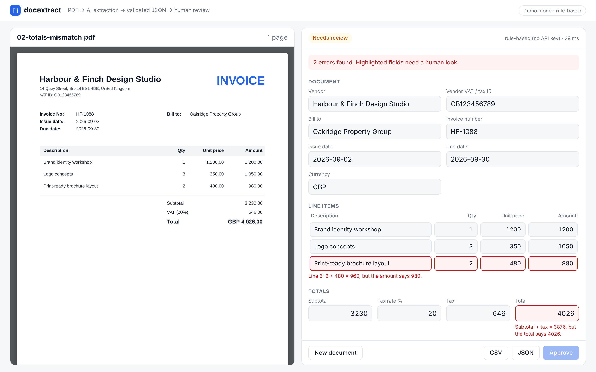
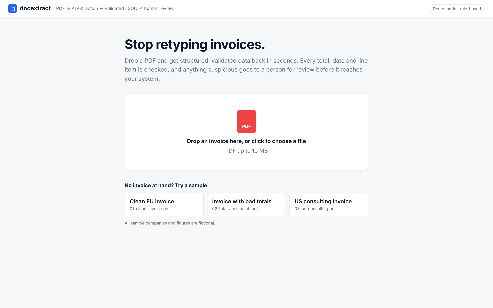
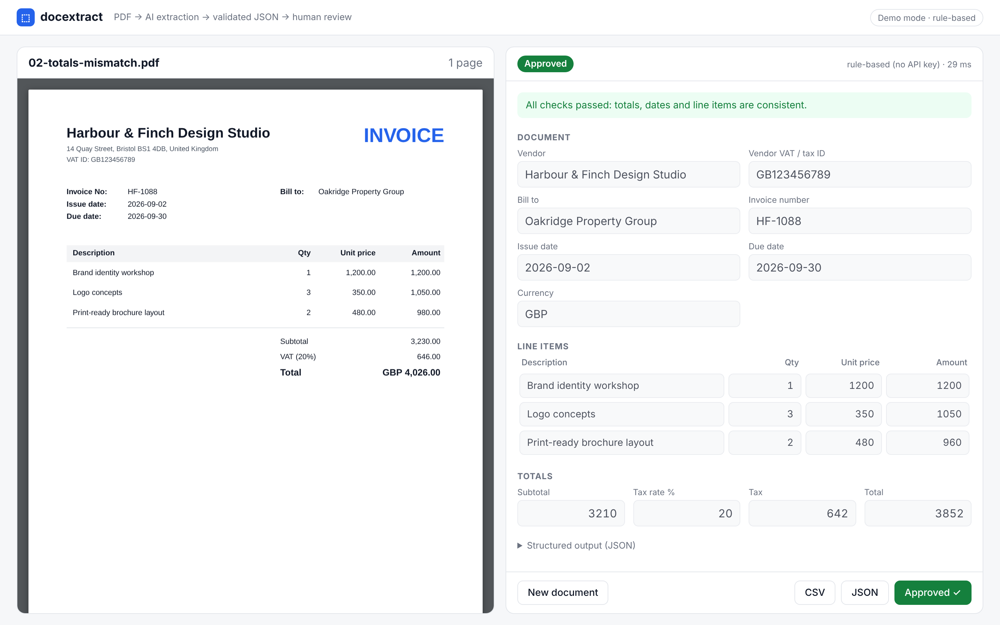
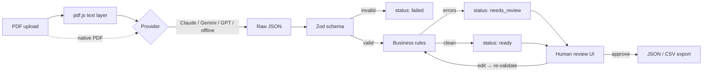

# docextract

**Turn PDF invoices into validated, structured data with LLMs, and route anything suspicious to a human before it reaches your system.**



Most "AI document extraction" demos stop at *"the model returned JSON"*. In production that is where the real problems start: the JSON is well-formed but the total is wrong, a date is impossible, or a line item was misread. This project shows the part that matters in production: **schema validation, business-rule checks, and a review step with an audit-friendly approve flow.**

## What it does

1. **Upload a PDF** (or pick one of the fictional samples).
2. **Extract**: the text layer and/or the PDF itself goes to an LLM (Claude, GPT or Gemini) with a strict JSON Schema.
3. **Validate** in two layers:
   - **Schema** (Zod): wrong types or missing structure → extraction marked `failed`, never saved.
   - **Business rules**: `qty × unit price = amount`, `Σ lines = subtotal`, `subtotal × rate = tax`, `subtotal + tax = total`, real ISO dates, due date after issue date, required identifiers, ISO currency.
4. **Review**: side-by-side PDF and editable fields; problems are highlighted inline and re-checked live as the reviewer types.
5. **Approve & export**: approval is blocked while errors remain; export as JSON or CSV (one row per line item, ready for a spreadsheet or ERP import).

| Upload | Fixed and approved |
|---|---|
|  |  |

## Run it

No API key needed: without one, the app uses an offline rule-based extractor so the whole pipeline can be tried immediately.

```bash
npm install
npm run build
npm start          # http://localhost:3000
```

Use a real LLM by setting one key (see `.env.example`):

```bash
ANTHROPIC_API_KEY=... npm start    # or OPENAI_API_KEY / GEMINI_API_KEY
```

Development with hot reload (API on :3000, UI on :5173):

```bash
npm run dev
```

Docker:

```bash
docker build -t docextract .
docker run -p 3000:3000 -e ANTHROPIC_API_KEY=... docextract
```

Tests:

```bash
npm test           # validation rules, parsers, and the full API flow
```

## Architecture



```
server/   Fastify + TypeScript API
  src/schema.ts            Zod schema = single source of truth (also emitted as JSON Schema for the LLM)
  src/pipeline/            pdf-text → extract → validate → export
  src/providers/           anthropic | openai | gemini | heuristic, behind one interface
  test/                    Vitest: rules, parsers, end-to-end API
web/      React + Vite review UI (pdf.js canvas preview, live validation)
samples/  Fictional invoices, generated by server/scripts/generate-samples.ts
```

### Design decisions

- **One provider interface.** Swapping Claude for Gemini (or Vertex AI) is a config change; validation and UI don't care which model ran.
- **Never trust model output.** The model is told to copy numbers *as printed*, not fix them; the code does the arithmetic. A vendor's own mistake (sample 2) is surfaced, not silently "corrected".
- **Errors vs warnings.** Errors block approval (totals don't add up). Warnings don't (tax rounding differences, unknown currency format).
- **Re-validation on every edit**, server-side, so the rules live in one place.
- **Bounded, defensive API**: 10 MB limit, `%PDF-` magic-byte check, no path traversal on samples, failed extractions return a clear status instead of a 500.

### What I'd add for production

- **Job queue** (BullMQ + Redis) so large batches don't block requests, with retries and dead-lettering.
- **PostgreSQL** with an `extraction_versions` table: every model output and every human edit stored, for audit and for measuring accuracy over time.
- **Evaluation set**: a labelled set of real documents and a script that reports per-field accuracy per model, so model or prompt changes are measured, not guessed.
- **Confidence routing**: auto-approve only documents that pass all rules *and* match known vendors; everything else goes to review.
- **OCR fallback** for low-quality scans and per-tenant schemas beyond invoices (statements, contracts, forms).

## License

MIT. Sample documents are fictional and generated by the script in this repository.
